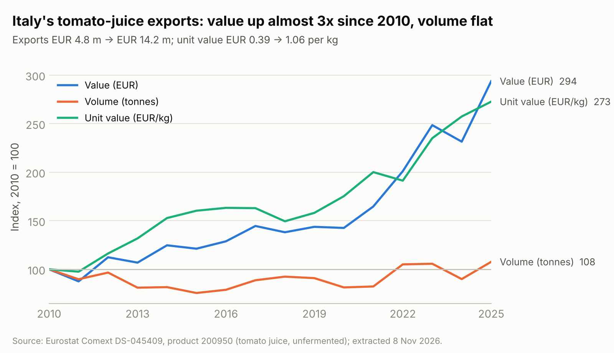
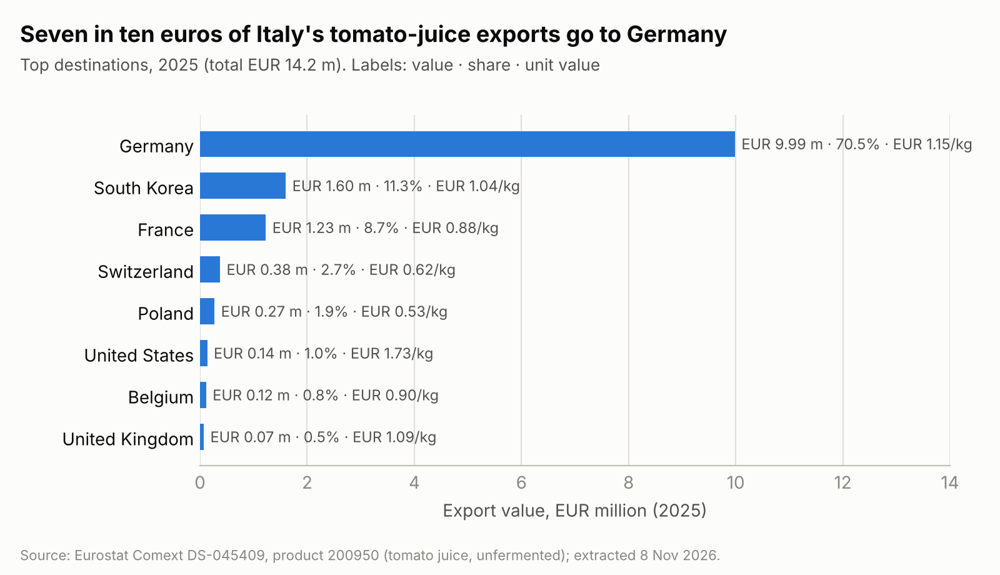
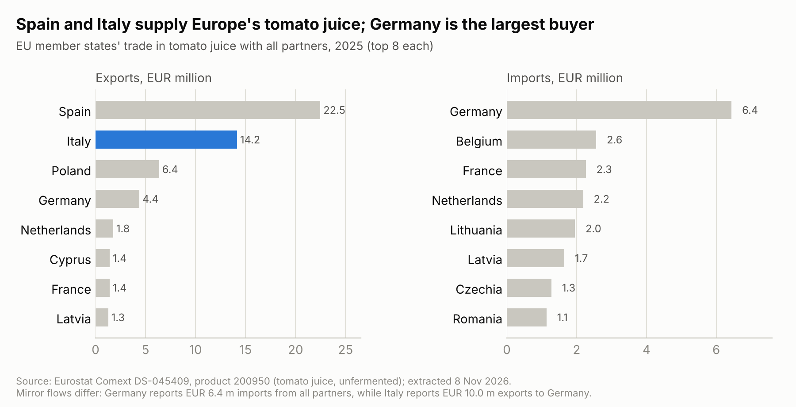
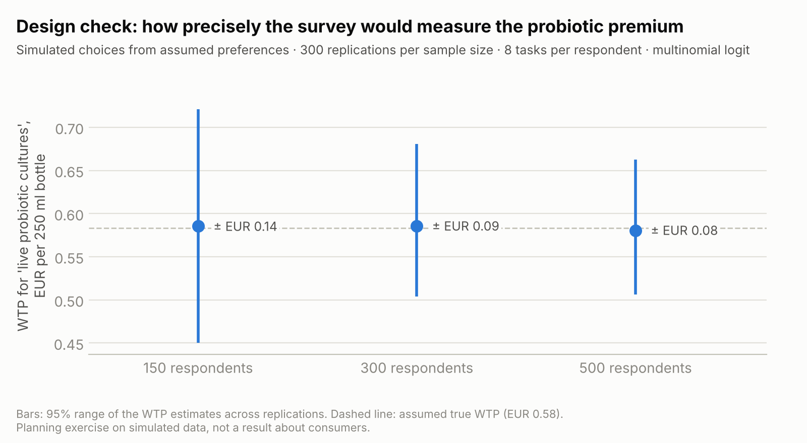

# Market study design for a probiotic tomato-based drink

*Hatef Tabbakhian · November 2026 · public data only; not affiliated with any company or project*

A probiotic tomato drink can start where tomato juice is already a habit: Germany buys 70% of Italy's
tomato-juice exports. It can also try to build a new wellness category in Italy. This repository sets out
how I would test both routes in a seven-month market study: what public trade data already shows, the
consumer survey and choice experiment I would run, and a simulation that sizes the sample.

A three-page summary with the figures is in [`docs/market_study_plan.pdf`](docs/market_study_plan.pdf).

## 1. Questions the study must answer

1. **Where is the demand:** in Italy, or in export markets that already drink tomato juice?
2. **Who buys:** which consumer segments, and how many of them?
3. **What sells it:** which attributes matter (probiotic claim, origin, organic, salt), and what price
   premium consumers accept for "live probiotic cultures".
4. **How much:** realistic volumes and revenues for the producers, under explicit scenarios.

## 2. What public data already shows

Source: Eurostat Comext, dataset DS-045409, product 200950 (tomato juice, unfermented). Code: `analysis/trade_analysis.py`.



- **Italy's tomato-juice exports reached EUR 14.2 m in 2025, from EUR 4.8 m in 2010** (index 294), while
  volume barely moved (12,358 t to 13,313 t, index 108). The value per kg rose from EUR 0.39 to EUR 1.06.
  That fits a move up-market, but part of it is raw-material cost: the price of processing tomatoes rose
  about 50% in four years, and 67% in the South (ANICAV, 2025). Separating the two needs price data,
  not trade data.
- **Exports grew 27% in 2025 alone** (EUR 11.2 m to EUR 14.2 m).



- **Demand is concentrated: Germany takes 70.5% of Italy's exports** (EUR 10.0 m), then South Korea (11.3%)
  and France (8.7%). Only 16.5% leaves the EU. Of the three main buyers, Germany pays the highest price
  per kg (EUR 1.15).



- **Italy is the EU's second exporter** (24% of member-state exports, after Spain's EUR 22.5 m). Germany is the
  largest importer. Italy imports almost nothing (EUR 0.6 m), so its home market is supplied domestically.

**What this means for the study.** A premium probiotic version has two routes. (a) Export to markets with a
tomato-juice habit (Germany first, then France, Benelux, the Baltics and South Korea), where it is an upgrade of a
known product. (b) Build a wellness category in Italy, where tomato juice looks like a niche drink (the
month-1 store checks will size it): harder, but it carries the strongest origin story. The survey should test
both, starting with Italy and Germany.

**Limits of trade data.** Code 200950 is a proxy: it covers unfermented juice, and a fermented probiotic
drink may be classified elsewhere. Trade values are not retail sales, and they say nothing about Italian
consumption (domestic production data would be needed). Mirror flows also differ: Germany reports
EUR 6.4 m of imports from all partners, while Italy reports EUR 10.0 m of exports to Germany. Small flows
can carry reporting errors too: Italy's 2025 exports to Lithuania are recorded as EUR 34,463 for 27 kg.

## 3. Product and industry context

| Topic | Evidence | Source |
| --- | --- | --- |
| Raw material | Italy processed about 5.8 million t of tomatoes in 2025: second in the world after the US (14.4% of world output, 53.8% of Europe's). ANICAV's member firms, about 70% of the sector, had a turnover of EUR 3.9 bn in 2024 and export about 60% of their output; Europe is the main outlet, Germany first | ANICAV, 1 Dec 2025 |
| Shelf life | In three fruit and vegetable juice blends, *L. casei*, *L. plantarum* and *L. reuteri* stayed above 6 log CFU/mL for 33 days at 4 °C and 4 more days after opening; 78 untrained panellists rated them 6.9–8.9 out of 9. Tomato was not tested | Condurso et al., *Foods*, 2025 |
| Demand signals | In six large European markets, plant-based drinks volumes +5.2% and yogurt-based drinks +12.3% in the last year; in Italy, drinks spending +2.9% with flat volumes | Circana, via Italian Food News, Oct 2026 |
| Purchase drivers | For functional drinks, past purchase frequency and the perceived reward are the strongest predictors of willingness to buy; women are more willing to buy fruit and vegetable functional drinks | Kowalska et al., *Decision*, 2024 (784 students in Poland) |
| Labelling | Italy's Ministry of Health guidelines let a product say "probiotico" on the label if the daily serving supplies at least 10<sup>9</sup> live cells of a safe, identified strain until the end of shelf life. The same guidelines note that this is not a health claim that can be authorised in the EU (Reg. 1924/2006, Art. 13.5) | Ministero della Salute, guidelines of March 2018 |

Practical consequences: roughly one month of chilled shelf life means chilled distribution, and the claim
tested in the survey must be one the producers can legally print. Label and lab are linked: for a 250 ml
bottle, 10<sup>9</sup> live cells means at least 4 million CFU/mL (6.6 log) at the end of shelf life.

## 4. Study plan (seven months)

| Month | Work | Output |
| --- | --- | --- |
| 1 | Desk research; store and online price checks in Italy and Germany; top-down market sizing | Price map, sizing v1 |
| 2 | Questionnaire and choice-experiment design with the lab and the producers; pilot with about 30 people | Final survey |
| 3–4 | Online panel: Italy n = 500, Germany n = 300 if the budget allows; quotas by age, gender and region. Tasting session with the lab's prototype (n = 60–80) | Clean dataset |
| 5 | Analysis: choice models, purchase intention, segments, sensory data (section 5) | WTP per attribute, segments |
| 6 | Bottom-up market model: target consumers × adoption × frequency × price, with Monte Carlo ranges; scenarios by country and channel | Volume and revenue ranges |
| 7 | Report and presentation to the producers; draft paper | Final report |

## 5. Consumer survey and choice experiment

Each respondent sees 8 choice tasks: two versions of the drink plus "I would buy neither". The draft design
(`analysis/dce_design.csv`) has 3 blocks of 8 tasks, no dominated alternatives and near level balance (exact
for the two-level attributes). It is a constrained random design, enough for planning; the final design
would be D-efficient, with priors from the pilot.

| Attribute | Levels |
| --- | --- |
| Price, 250 ml bottle | EUR 1.50 · 2.00 · 2.50 · 3.00 (to be calibrated with store checks) |
| Probiotic | none · "with live probiotic cultures" |
| Tomato origin | not stated · Italian · Campanian |
| Organic | no · yes |
| Salt | standard · no added salt |

**Models.** A multinomial logit as the baseline; a mixed logit for preference heterogeneity, and a latent-class
model for segments. Willingness to pay = −β(attribute) / β(price), with delta-method or Krinsky–Robb intervals.
Also: an ordered logit on purchase intention; quantile regression on stated WTP (drivers can differ between
low- and high-WTP buyers); ANOVA and penalty analysis on the tasting scores.

**Sample size.** The Johnson–Orme rule of thumb, N ≥ 500 · c / (t · a), gives at least 125 respondents
(c = 4 price levels, t = 8 tasks, a = 2 products per task: 500 · 4 / 16). The rule says nothing about
precision, so a simulation from assumed preferences (`analysis/dce_design_and_power.py`) shows what more
respondents buy:



With the assumed preferences, the premium for "live probiotic cultures" is recovered within ±EUR 0.14 at 150
respondents, ±EUR 0.09 at 300 and ±EUR 0.08 at 500. The plan is therefore at least 300 respondents per country.
These are simulated data: the real values come from the survey. The simulation assumes everyone has the same
preferences; real preferences differ between people, so real intervals are likely to be wider.

## 6. Main risks and how the study measures them

| Risk | How the study handles it |
| --- | --- |
| Taste: savoury drinks are a smaller habit than sweet ones | Tasting session linked to the survey; penalty analysis on saltiness and acidity |
| Shelf life of live cultures | Distribution scenarios built on the lab's viability data |
| Labelling of the probiotic claim | Test only wording the producers can use; legal check in month 1 |
| Price premium | Choice-experiment WTP versus the producers' cost floor |
| Hypothetical bias in stated WTP | Cheap-talk script in the survey; compare with the tasting group |

## Reproduce

```bash
pip install -r requirements.txt
python analysis/trade_analysis.py          # indicators + figures 1-3 from data/
python analysis/dce_design_and_power.py    # choice design + figure 4 (about 20 s)
python analysis/fetch_eurostat.py          # optional: refresh data/ from the Eurostat API
python docs/build_pdf.py                   # optional: rebuild the PDF (needs playwright and Chromium)
```

## Sources

- Eurostat, Comext database, dataset DS-045409 "EU trade since 1988 by HS2-4-6 and CN8", product 200950; extracted 8 November 2026 through the Eurostat dissemination API and checked again against it on 10 November 2026 (dataset last updated 16 October 2026).
- ANICAV, press release "Il Filo Rosso del Pomodoro 2025", Naples, 1 December 2025: https://anicav.it/wp-content/uploads/2025/12/CS-Filo-Rosso-2025.pdf
- Condurso C., Merlino M., et al. (2025). Developing novel plant-based probiotic beverages: a study on viability and physicochemical and sensory stability. *Foods* 14(12): 2148. https://doi.org/10.3390/foods14122148
- Kowalska A., Leoniak K., Sołowiej B.G. (2024). Consumers' attitudes and intentions toward functional beverages: a lesson for producers and retailers. *Decision* 51(3): 321–337. https://doi.org/10.1007/s40622-024-00395-y
- Circana trends of the European drinks market, reported by Italian Food News, 5 October 2026: https://www.italianfoodnews.it/2026/10/05/da-circana-arrivano-i-trend-del-mercato-europeo-delle-bevande-analcoliche-e-non/
- Ministero della Salute, *Linee guida su probiotici e prebiotici*, revision of March 2018 (sections 1.3 and 1.5, and the introduction): https://www.salute.gov.it/new/it/pubblicazione/linee-guida-probiotici-e-prebiotici-indicazioni-alimenti-e-integratori-contenenti/
- Regulation (EC) No 1924/2006 on nutrition and health claims made on foods.
- Johnson R., Orme B. (2003). Getting the most from CBC. Sawtooth Software Research Paper Series. The rule is set out in de Bekker-Grob E.W., Donkers B., Jonker M.F., Stolk E.A. (2015). Sample size requirements for discrete-choice experiments in healthcare: a practical guide. *The Patient* 8(5): 373–384. https://doi.org/10.1007/s40271-015-0118-z
